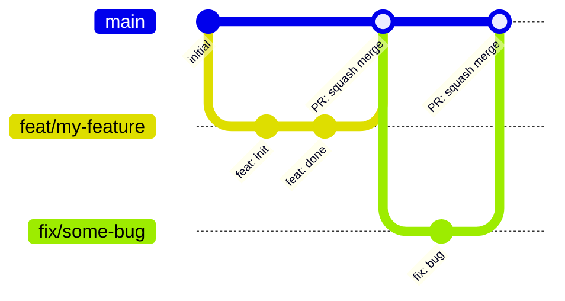

# Contributing

## Branching Strategy

RAFT has one persistent branch, `main`, and no integration branch: few people
work on RAFT at the same time, so topic branches merge straight into `main`.

| Branch | Created from | Merges into |
|---|---|---|
| `main` | — | — |
| `<type>/<description>` | `main` | `main`, through a pull request |

`<type>` is the [Conventional Commits](https://www.conventionalcommits.org/en/v1.0.0/)
type of the change (`feat`, `fix`, `docs`, `refactor`, `test`, `chore`, `perf`,
`ci`), and `<description>` is short kebab-case, e.g. `fix/fracture-leak-off` or
`chore/open-source-release`. The branch name and its commits then say the same
thing.



### Merge Requirements

- Every change reaches `main` through a GitHub pull request with one approving review.
- The `tests` workflow passes, and the branch is up to date with `main`.
- The pull request is **squash-merged**, and the branch is deleted afterwards.

Maintainers configure this on GitHub:

1. **Settings → General → Pull Requests:** allow squash merging, and turn on
   **Automatically delete head branches**.
1. **Settings → Rules → Rulesets**, on the default branch: Restrict deletions,
   Block force pushes, Require a pull request before merging (1 approval), and
   Require status checks to pass with the `tests` jobs, with Require branches to
   be up to date before merging.

## Setup

After cloning, install the git hooks using `prek`:
```bash
uv run prek install
uv run prek install --hook-type pre-push
```

This enforces code quality and prevents accidental direct commits or pushes to `main`. We split these checks to keep your development fast:
- **`pre-commit` (auto-format as you type):** Runs fast linting and formatting (Ruff).
- **`pre-push` (test before you share):** Runs heavier validation (Mypy type checking, Pytest) only when sharing code with the remote.

The `gitleaks` hook checks only what each commit stages. `just leaks` scans the whole history, every branch and tag. prek builds [gitleaks](https://github.com/gitleaks/gitleaks) itself, at the version pinned in `.pre-commit-config.yaml`, so it needs no separate install.

## Changelog

[`CHANGELOG.md`](CHANGELOG.md) follows the [Keep a Changelog](https://keepachangelog.com/en/1.1.0/)
convention, using the standard KaC entry types:

| Category | When to use |
|---|---|
| `Added` | New user-visible functionality |
| `Changed` | Internal restructuring or behaviour change |
| `Deprecated` | Features that will be removed in a future version |
| `Removed` | Features removed in this version |
| `Fixed` | Defect corrections |
| `Security` | Security-related fixes |

Entries live under a `## [In Development]` heading at the top of the file
until a release is cut. Each `[In Development]` block may optionally note the
associated MR number in the **body** (not the heading) for traceability.

> **Public release note**: if/when this project is released publicly and adopts
> [Semantic Versioning](https://semver.org/), rename the `[In Development]`
> heading to `[Unreleased]` and update the footer link label to match. This
> aligns with the standard KaC convention and is expected by most changelog
> tooling (e.g. `git-cliff`, `standard-changelog`).

### When to add an entry

| Project phase | Merges into `main` | Releases |
|---|---|---|
| **Pre-1.0** (current) | **Required** | **Required** |
| **Post-1.0** | Optional | **Required** |

**Pre-1.0 rationale**: Before the first release the changelog is the primary
record of what TANGO is becoming. Every merge into `main` represents a
meaningful, reviewable change that an end-user or future contributor will want
to understand, so an entry is expected.

**Post-1.0 rationale**: Once releases are the primary communication mechanism,
individual merges need not be documented — but every release *must* have a
complete entry so that upgrading users know exactly what changed.

### Format

The changelog is structured around **merge requests into `main`**, not releases.
Keep a `## [In Development]` stub at the very top for ongoing work. Right before a MR
is merged into `main`, convert it into a named section:

```markdown
## [In Development]

*(Nothing yet.)*

---

## MR !<N> — YYYY-MM-DD: <short title>

Optional summary paragraph.
[Link to MR !<N>](<gitlab MR URL>)

### Added
- **<Thing>** — description.

### Fixed
- **<Thing>** — description.
```

When the first public release is cut, group the relevant MR sections under a
`## [1.0.0] — YYYY-MM-DD` heading, rename `[In Development]` to `[Unreleased]`
(see note above), and update the footer comparison links at the bottom of `CHANGELOG.md`.

### Tagging deleted branches

GitLab prunes branch refs when branches are deleted, which would break
`CHANGELOG.md` comparison links. To preserve a permanent pointer to where a
branch landed, the CI pipeline automatically creates a lightweight git tag
named `bak/<branch-name>` at the end of every successful merge request
pipeline — right before the reviewer clicks merge and the squash happens.

> **Prerequisite**: The `tag_branch` CI job needs a Project Access Token with
> `write_repository` scope to push tags. Create one under
> **Settings → Access Tokens → Add new token** (role: **Developer**,
> scope: **write\_repository**). GitLab shows the token value only once —
> copy it immediately and add it as a CI/CD variable under
> **Settings → CI/CD → Variables** with these settings:
> - **Key**: `GITLAB_PUSH_TOKEN`
> - **Value**: paste the token here
> - **Visibility**: Masked (redacts the value from job logs)
> - **Protect variable**: unchecked (protected variables are not injected into
>   unprotected MR branches, so the job would never see the token)
>
> You do not need to store the token value anywhere else.

If you ever need to do this manually (e.g. CI is unavailable):

```bash
git tag bak/fix/some-bug                              # lightweight tag with bak/ prefix
git push origin refs/tags/bak/fix/some-bug            # push the tag explicitly
git push origin --delete refs/heads/fix/some-bug      # delete branch explicitly
```

This is a well-established practice — unlike branches, tags are static pointers
to a specific commit. This ensures the commit remains reachable even after the
branch ref disappears.

> **Convention**: prefix *release* tags with `v` (e.g. `v1.2.0`) and
> branch-preservation tags with `bak/` (e.g. `bak/fix/some-bug`).

The `CHANGELOG.md` footer will then look like:

```markdown
[Unreleased]: https://github.com/your-org/your-repo/compare/v1.2.0...HEAD
[1.2.0]: https://github.com/your-org/your-repo/compare/v1.1.0...v1.2.0
[1.1.0]: https://github.com/your-org/your-repo/releases/tag/v1.1.0
```

## License headers

RAFT is licensed under Apache-2.0 and follows the [REUSE](https://reuse.software/) specification. Every Python file starts with:

```python
# SPDX-FileCopyrightText: 2026 ETH Zurich
# SPDX-License-Identifier: Apache-2.0
```

A shebang line, if any, stays above them. Other files are covered by the file-type patterns in [`REUSE.toml`](REUSE.toml), which deliberately leave out `*.py`, so a Python file without the header fails the check. A file of a new type fails it too: add its pattern to `REUSE.toml`. A file from a third party keeps its own copyright and license: give it an annotation in `REUSE.toml`, and add its license text to `LICENSES/`. The `reuse` prek hook runs `reuse lint` on every commit.

## Cutting a release

Every release goes to [TestPyPI](https://test.pypi.org/project/geg-raft/) first and to [PyPI](https://pypi.org/project/geg-raft/) only after the TestPyPI upload installs and runs. PyPI never accepts the same version twice, so a broken upload there can't be replaced. Tags carry a `v` prefix. [`.github/workflows/release.yml`](.github/workflows/release.yml) does the uploads with PyPI Trusted Publishing, so no API token is stored anywhere.

1. Check that `## [In Development]` in `CHANGELOG.md` covers the release, then rename it to `## [X.Y.Z] — YYYY-MM-DD` and set `version` and `date-released` in `CITATION.cff`.
2. Bump `version` in `pyproject.toml` through a pull request, and merge it into `main`.
3. Tag that commit on `main` and push the tag. Never reuse a version number.

   ```bash
   git checkout main && git pull
   git tag vX.Y.Z
   git push origin refs/tags/vX.Y.Z
   ```

4. The tag starts the `release` workflow. It checks that the tag matches `version` in `pyproject.toml`, builds the wheel and sdist once, and uploads them to TestPyPI.
5. Install the TestPyPI upload in a fresh directory and check it runs. The extra index supplies the dependencies, which are not on TestPyPI:

   ```bash
   uv venv && uv pip install --index-url https://test.pypi.org/simple/ --extra-index-url https://pypi.org/simple/ --index-strategy unsafe-best-match geg-raft==X.Y.Z
   uv run python -c "import geg_raft"
   ```

6. If it works, approve the waiting `publish to PyPI` job in the workflow run (Actions → release). The same files go to PyPI. If it doesn't, leave the job unapproved, fix the problem, and release the next patch version; that version number is spent on TestPyPI.
7. Create a GitHub Release from the tag with the changelog section as its notes (`gh release create vX.Y.Z --verify-tag --title X.Y.Z --notes-file notes.md`).

### One-time setup

- On [pypi.org](https://pypi.org/manage/account/publishing/) and [test.pypi.org](https://test.pypi.org/manage/account/publishing/), add a trusted publisher for the project: owner `GEG-ETHZ`, repository `RAFT`, workflow `release.yml`, environment `pypi` on PyPI and `testpypi` on TestPyPI. Before the first upload this is a "pending publisher", which also reserves the name.
- In the repository's Settings → Environments, create `testpypi` with no protection rules and `pypi` with a required reviewer.
