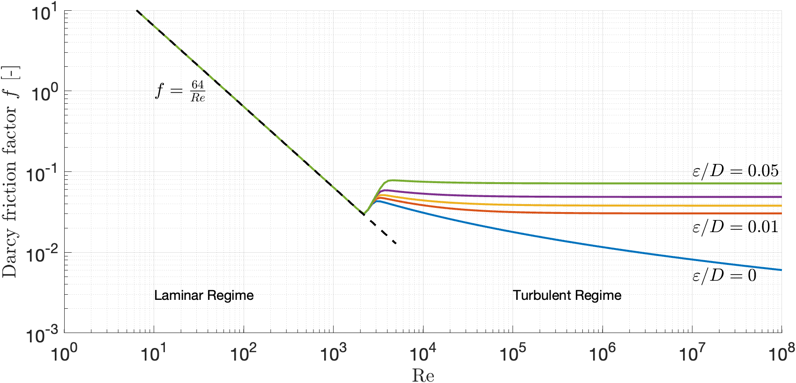
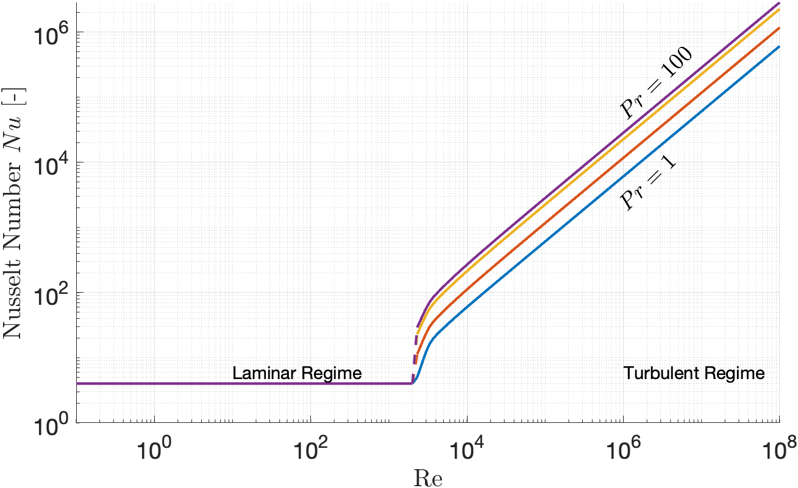

# Theory — Governing Equations and Numerical Methods

RAFT idealizes the subsurface as a continuous, fully-saturated, single-phase porous medium and solves a coupled thermo-hydraulic (pressure/temperature) finite element problem with a **compressible, pressure- and temperature-dependent fluid equation of state (EOS)**: density, internal energy, enthalpy, and viscosity are functions of $(p,T)$, from either a closed-form weakly-compressible relation or real-fluid CoolProp lookups. This section presents the strong and weak forms, the fluid EOS, spatial and temporal discretization, stabilization, and the solution scheme.

## Table of Contents
- [Symbol Glossary](#symbol-glossary)
- [Strong Form Governing Equations](#strong-form-governing-equations)
    - [Conservation of Mass](#conservation-of-mass)
    - [Conservation of Energy](#conservation-of-energy)
    - [Fluid Equation of State](#fluid-equation-of-state)
- [Weak Form and Finite Element Discretization](#weak-form-and-finite-element-discretization)
- [Fracture Coupling](#fracture-coupling)
- [Fracture Mesh Cutting Algorithm](#fracture-mesh-cutting-algorithm)
- [Well Coupling](#well-coupling)
- [Advection Stabilization (SUPG)](#advection-stabilization-supg)
- [Time Discretization and Solution Scheme](#time-discretization-and-solution-scheme)
- [Adaptive Timestep Control](#adaptive-timestep-control)
- [Tangent Matrices](#tangent-matrices)

## Symbol Glossary

| Symbol | Definition | Unit | Type |
|---|---|---|---|
| $p$ | Fluid pressure | $Pa$ | Primary variable |
| $T$ | Temperature | $^\circ K$ | Primary variable |
| $T_{flow}$ | Temperature at which $\rho_f$ (and $\mu$) is evaluated | same as $T$ | Auxiliary field, see [T_flow vs. T](#tflow-vs-t) |
| $\rho_f$ | Fluid density | $kg/m^3$ | EOS output, $\rho_f(p,T_{flow})$ |
| $u_f$ | Fluid specific internal energy | $J/kg$ | EOS output, $u_f(p,T)$ |
| $h_f$ | Fluid specific enthalpy, $h_f=u_f+p/\rho_f$ | $J/kg$ | EOS output |
| $c_{pf}$ | Fluid specific heat capacity at constant pressure, $(\partial h_f/\partial T)_p$ | $J/kg/^\circ K$ | EOS-derived (SUPG use only) |
| $\alpha_f$ | Instantaneous fluid thermal expansion, $-\frac{1}{\rho_f}\frac{\partial \rho_f}{\partial T}$ | $^\circ K^{-1}$ | EOS-derived |
| $\rho_s$ | Rock matrix density | $kg/m^3$ | Material property |
| $\boldsymbol{k}_f$ | Permeability tensor | $m^2$ | Material property |
| $\mu$ | Fluid viscosity | $Pa\cdot s$ | EOS output, $\mu(p,T_{flow})$ |
| $\vec{g}$ | Gravity vector | $m/s^2$ | Boundary condition |
| $\alpha_s$ | Volumetric coefficient of thermal matrix expansion | $^\circ K^{-1}$ | Material property |
| $\phi$ | Eulerian porosity | - | Derived property, $\phi(p)$ |
| $\phi_L$ | Lagrangian porosity, $\phi_L=\phi(1+\epsilon)$ | - | Derived property |
| $\epsilon$ | Volumetric strain (skeleton, non-mechanical) | - | Derived property |
| $\beta$ | Biot effective pressure coefficient, $1-K_d/K_s$ | - | Material/derived property |
| $K_d$ | Drained bulk modulus of porous media | $Pa$ | Material/derived property |
| $K_s$ | Bulk modulus of solid matrix | $Pa$ | Material property |
| $K_f$ | Fluid bulk modulus (closed-form EOS only) | $Pa$ | Material property |
| $Q_i$ | Volumetric fluid injection per injection point | $m^n/s$ | Boundary condition |
| $\vec{q}_D$ | Darcy (volumetric) flux | $m^3/s/m^2$ | Derived property |
| $\vec{q}$ | Mass flux, $\rho_f\vec{q}$ | $kg/s/m^2$ | Derived property |
| $c_{ps}$ | Specific heat capacity of matrix | $J/kg/^\circ K$ | Material property |
| $\boldsymbol{\lambda}_f$ | Fluid thermal conductivity tensor | $W/m/^\circ K$ | Material property |
| $\boldsymbol{\lambda}_s$ | Matrix thermal conductivity tensor | $W/m/^\circ K$ | Material property |
| $\boldsymbol{\lambda}_e$ | Effective thermal conductivity tensor | $W/m/^\circ K$ | Derived property |
| $\Omega$ | Domain | | Domain |
| $\Gamma$ | Boundary | | Boundary |

## Strong Form Governing Equations
#### Conservation of Mass
Flow is governed by conservation of mass with Darcy's law, assuming a fully-saturated, single-phase medium, idealized as a continuous porous medium:

$$\frac{\partial}{\partial t}(\phi \rho_f) + \rho_f \phi \dot{\epsilon} = \nabla\cdot \vec{q} + \rho_f Q_i\delta(\vec{X}_i) \quad \forall \vec{X}\in\Omega$$

$$\vec{q} = \frac{\rho_f \boldsymbol{k}_f}{\mu}\left(\nabla p - \rho_f \vec{g}\right)$$

The first term on the left-hand side corresponds to the rate of fluid accumulation in the changing pore space, while the second term corresponds to the bulk change in the frame (the additional volume gained by or lost by changes in the frame volume). We combine these terms to define the Lagrangian porosity, $\phi_L=\phi(1+\epsilon)$. The first term on the right-hand side is the divergence of the Darcy mass flux ($\vec{q}$), and the last term represents point sources.

Porosity is defined neglecting deformation from external mechanical loads/equilibrium but including volumetric strain from pore-pressure and thermal changes, and assuming the matrix and solid-grain thermal expansions are approximately equal $\alpha_m\approx\alpha_s$. Thus the temperature does not itself change porosity — a linear change in all dimensions scales void and solid volume equally. The strain and porosity become

$$\epsilon = \frac{\beta}{K_d}(p-p_0) + \alpha_s(T-T_0), \qquad \phi(p) = 1-(1-\phi_0)e^{-(p-p_0)/K_d}, \qquad \beta=1-\frac{K_d}{K_s}$$

#### Conservation of Energy
Temperature is governed by conservation of energy assuming local thermal equilibrium between rock and fluid (a single temperature field for the porous medium — not valid across highly conductive fracture apertures, where a separate fracture/matrix convective exchange is used instead, see [Fracture Coupling](#fracture-coupling)):

$$\frac{\partial}{\partial t}\left[(1-\phi_L)\rho_s c_{ps} T + \phi_L \rho_f u_f\right] = -\nabla\cdot( h_f \vec{q}) + \nabla\cdot(\lambda_e \nabla T) + Q_{Ti}\delta(\vec{X}_i) \quad \forall \vec{X}\in\Omega$$

with effective thermal conductivity mixed by (Lagrangian) porosity, $\lambda_e = \phi_L\lambda_f + (1-\phi_L)\lambda_s$, and work done by expansion of the solid matrix neglected relative to the temperature term.

The coupled problem seeks $p(\vec{X},t)$ and $T(\vec{X},t)$ satisfying the above everywhere in $\Omega$, subject to initial conditions $p_0(\vec{X})$, $T_0(\vec{X})$, Dirichlet boundary conditions $\overline{p}(t)$, $\overline{T}(t)$ on $\Gamma_D$, and Neumann (flux) boundary conditions on $\Gamma_N$:

$$\vec{q}= \overline{\vec{q}}_M(t), \qquad \vec{q}_T = -\lambda_e \nabla T = \overline{\vec{q}}_T(t)$$

where $\Gamma = \Gamma_N \cup \Gamma_D$, $\Gamma_N \cap \Gamma_D = \emptyset$.

#### Fluid Equation of State
The mass and energy balances above are closed by a nonlinear fluid EOS providing $\rho_f$, $u_f$, $h_f$, and $\mu$ as functions of $(p,T)$. There are two mutually exclusive EOS provided in the code.

**Boussinesq Approximation** evaluated about the reference state $(p_0,T_0)$:

$$\rho_f(p,T) = \rho_0\left(1-\alpha_f(T-T_0) +\frac{p-p_0}{K_f}\right), \qquad u_f(p,T) = c_{pf}T - \frac{\alpha_f T p}{\rho_0} + \frac{p^2}{2K_f\rho_0}$$

The Boussinesq approximation is suitable for problems with low compressibility of coefficients of expansion, which $\rho_f\approx\rho_0$, or problems with a small bound of pressure and temperature. The internal energy relation follows from integrating the differential

$$du_f = \left(c_{pf}-\frac{\alpha_f}{\rho_f}p\right)dT + \frac{1}{\rho_f}\left(\frac{p}{K_f}-\alpha_f T\right)dp$$

**Real-fluid EOS**: $\rho_f$, $u_f$, and their $(p,T)$ derivatives come from a CoolProp Helmholtz-energy equation of state, for any CoolProp-supported `fluid_type` (e.g. water or CO2). $T$ and $p$ are clipped to $274$–$1900\,K$ and $0.1$–$700\,MPa$ before each lookup, keeping unconverged Newton iterates inside CoolProp's valid range.

**Enthalpy** is reconstructed rather than queried directly, $h_f = u_f + p/\rho_f$, and $c_{pf}=(\partial h_f/\partial T)_p$ is likewise obtained by stripping the pressure-work derivative from $\partial u_f/\partial T$ rather than differentiating $h_f$ directly; $c_{pf}$ is used only to weight the SUPG stabilization (below), not in the energy residual itself.

## Weak Form and Finite Element Discretization
To develop the weak forms, we multiply the governing equations by admissible variations $\delta p$, $\delta T$ and integrating over the domain. Applying the divergence theorem to the flux terms (the Dirichlet contribution vanishes since $\delta p=\delta T=0$ there, and the Neumann contribution reduces to the prescribed flux) gives:

$$0 = \int_{\Omega} \delta p\, \frac{\partial}{\partial t}(\phi_L \rho_f)\,d\Omega + \int_{\Omega} \nabla\delta p\cdot \frac{\rho_f \boldsymbol{k}_f}{\mu}(\nabla p - \rho_f \vec{g})\,d\Omega \\
+ \oint_{\Gamma_N}\delta p\,\overline{\vec{q}}_M\cdot\vec{n}\,d\Gamma_N - \int_{\Omega}\delta p\,\rho_f Q_i\delta(\vec{X}_i)\,d\Omega$$

$$0 = \int_{\Omega} \delta T\, \frac{\partial}{\partial t}\left[(1-\phi_L)\rho_s c_{ps}T + \phi_L \rho_f u_f\right] d\Omega + \int_{\Omega} \nabla\delta T \cdot h_f \vec{q}\,d\Omega - \oint_\Gamma \delta T() h_f \vec{q})\cdot\vec{n}\,d\Gamma \\
- \int_{\Omega} \nabla\delta T \cdot \lambda_e \nabla T\,d\Omega - \oint_{\Gamma_N} \delta T\,\overline{\vec{q}}_T\cdot\vec{n}\,d\Gamma_N - \int_{\Omega} \delta T\, Q_{Ti}\delta(\vec{X}_i)\,d\Omega$$

Discretizing with standard isoparametric shape functions $p^h=\textbf{N}(\vec{X})\textbf{p}(t)$, $T^h=\textbf{N}(\vec{X})\textbf{T}(t)$ (gradients $\nabla p^h=\textbf{B}(\vec{X})\textbf{p}(t)$, $B_{ij}=\partial N_j/\partial x_i$) gives element residual vectors $\textbf{R}_p=0$, $\textbf{R}_T=0$:

$$\textbf{R}_p = \textbf{F}_{Pstorage} - \textbf{F}_{Pdiffusion} - \textbf{F}_{ext,p} = 0$$

| Term | Definition | Description |
|---|---|---|
| $\textbf{F}_{Pstorage}$ | $\textbf{M}_{lump}\frac{d}{dt}(\phi_L\rho_f)$ | Lumped nodal mass storage rate |
| $\textbf{F}_{Pdiffusion}$ | $\int_\Omega \textbf{B}^\top \vec{q}\,d\Omega$ | Darcy mass-flux (conductance) vector; gravity is embedded in $\vec{q}=\rho_f\vec{q}$ |
| $\textbf{F}_{ext,p}$ | Prescribed Neumann flux + point-source (wellbore) terms | External/source forcing |

$$\textbf{R}_T = \textbf{F}_{Tstorage} + \textbf{F}_{Tdiffusion} - \textbf{F}_{Tadvection} + \textbf{F}_{Tstab} - \textbf{F}_{ext,T} - \textbf{F}_{enth,\Gamma} = 0$$

| Term | Definition | Description |
|---|---|---|
| $\textbf{F}_{Tstorage}$ | $\textbf{M}_{lump}\frac{d}{dt}\left[(1-\phi_L)\rho_s c_{ps}T + \phi_L\rho_f u_f\right]$ | Lumped nodal energy storage rate |
| $\textbf{F}_{Tdiffusion}$ | $\int_\Omega \textbf{B}^\top \lambda_e\textbf{B}\textbf{T}\,d\Omega$ | Heat conduction vector |
| $\textbf{F}_{Tadvection}$ | $\int_\Omega \textbf{B}^\top h_f\vec{q}\,d\Omega$ | Enthalpy advection vector |
| $\textbf{F}_{Tstab}$ | see [SUPG](#advection-stabilization-supg) | Streamline-upwind stabilization |
| $\textbf{F}_{ext,T}$ | Prescribed Neumann heat flux | External forcing |
| $\textbf{F}_{enth,\Gamma}$ | see below | Advective enthalpy boundary correction |

$\textbf{F}_{Pstorage}$/$\textbf{F}_{Tstorage}$ use a **lumped-mass** discretization (nodal rather than quadrature-point quantities) to suppress spurious transient oscillations. The row-sum lumped mass matrix is diagonal,

$$M_{lump,ii} = \sum_j\int_\Omega N_i N_j\,d\Omega = \int_\Omega N_i\,d\Omega,$$

and the storage rates are evaluated from nodal values, e.g. $F_{Pstorage,i} = M_{lump,ii}\,\frac{d}{dt}(\phi_L\rho_f)_i$.

**Advective enthalpy boundary correction** ($\textbf{F}_{enth,\Gamma}$) is a node-wise correction applied at an open pressure/flux (inflow or outflow) node whose temperature is otherwise unconstrained. The inflow/outflow otherwise acts as a false source of energy, and the spurious enthalpy contributions must be removed. $\textbf{F}_{enth,\Gamma}$ subtracts the enthalpy flux $q\,h_f(p,T)$ at that node - where $q$ is the node's mass flow rate and $h_f$ its current enthalpy — to impose an advective open condition on the boundary.

## Fracture Coupling
Fractures are modelled as lower-dimensional manifolds (line elements in 2D) embedded in, and conforming to, the surrounding matrix mesh, rather than as full-dimensional low-permeability regions. Each fracture element solves a reduced-dimensional pressure/temperature system restricted to the fracture plane, and exchanges flow and heat with the matrix elements it cuts through, requiring a conforming cut of the bulk mesh (currently 2D only — see [`fractures`](README.md#fractures-optional-field)).

**Governing equations.** The fracture void is treated as fully fluid-filled (no solid phase) defined hydraulic aperture $w$. Conservation of mass, restricted to the fracture's local tangential coordinate $s$ ($\nabla_\parallel \to\partial/\partial s$ for fracture tangent $\vec{u}$), are:

$$\frac{\partial}{\partial t}(w\rho_f) = \nabla_\parallel \cdot\left(\frac{\rho_f w \boldsymbol{k}_f}{\mu}(\nabla_\parallel p_f - \rho_f\vec{g})\right) + \rho_f Q_i\delta(\vec{X}_i) - Q_{leak}\\
Q_{leak} = \frac{\rho_f}{\mu} h_{k\perp}(p_f-p_m) \\
 \boldsymbol{k}_f = \frac{w^2}{12}, \quad h_{k\perp} = \frac{w}{12}$$

in which $Q_{leak}$ is the mass exchange between matrix and fracture, $\boldsymbol{k}_f$ is the effective permeability along the fracture, and $h_{k\perp}$ is the fracture mass exchange coefficient.

The conservation of energy is

$$\frac{\partial}{\partial t}(w\rho_f u_f) = -\nabla_\parallel \cdot( h_f w Q_{leak}) + \nabla_\parallel \cdot(w\lambda_f\nabla T) - Q_{E}  $$

where the total heat energy exchange rate $Q_{E}$ is:

$$Q_{E} = \underbrace{h_c (T_f - T_m)}_{\text{Conductive Exchange}} + \underbrace{Q_{\text{leak}} h_f^*}_{\text{Advective Enthalpy Exchange}} \\
h_c = F \, \frac{\text{Nu} \cdot \lambda_f}{2w}$$

in which $h_c$ is the conductive heat transfer coefficient and $h_f^*$ is the directional upwind enthalpy based on flow direction:

$$h_f^* =
    \begin{cases}
      h_f(T_f, p_f) & \text{if } p_f \ge p_m \quad \text{(Flow from Fracture to Matrix)} \\
      h_f(T_m, p_m) & \text{if } p_f < p_m \quad \text{(Flow from Matrix to Fracture)}
    \end{cases}$$

For evaluating the exchange direction, the pressure is lagged to the previous timestep to prevent intra-timestep oscillating.

$Nu$ is the Nusselt number based on the parallel-plate hydraulic diameter $2w$, $F$ is the heat transfer factor, $p_m$/$T_m$ are the matrix pressure/temperature at the fracture face, and $p_f/T_f$ are the mean pressure and temperature across the fracture aperture. Heat and mass exchange between the fractures and matrix do not assume thermal equilibrium across the aperture. Cubic-law flow is laminar, for which steady, fully-developed flow between parallel plates gives $Nu = 7.54$ at constant wall temperature and $Nu = 8.23$ at constant wall heat flux (Bejan, 2013). The coupled fracture-matrix problem fits neither boundary condition exactly, so their average, $Nu = 7.885$, is used. The factor $F$ scales the exchange: $F < 1$ reduces it, $F = 0$ insulates the fracture, and local thermal equilibrium can be approached with an arbitrarily large $F$.

## Fracture Mesh Cutting Algorithm
Fracture coupling requires a mesh that conforms to each fracture line, so RAFT cuts an ordinary matrix mesh to fit (2D only).

* **Level sets.** Fracture geometry is calculated by level sets, a normal and tangential level set describe the signed distance from the fracture.
* **Fracture element size follows the matrix mesh.** Fracture nodes aren't placed at any independent resolution — a new node is only added where the fracture line actually crosses an edge of the existing matrix mesh (a sign change in $\phi$ between the edge's two endpoints). So the fracture mesh has exactly as many elements as matrix element edges it passes through, and its element size locally matches the surrounding matrix mesh.
* **Snapping tolerance.** To prevent sliver elements, fracture nodes snap to the existing matrix node locations when they are close. This can create local deiviations from the linear fracture geomery. The tolerance is determined by the lesser of a domain scale and a local mesh scale. The domain scale is $\approx 0.005\times$ the domain's characteristic length. The mesh scale is the 1st percentile of the local matrix edge length found in a strip along the fracture line. To improve the geometry of the fracture representation and prevent local deviations, use a finer mesh along the fracture line.
* **Junction placement.** Fracture junctions are placed before any cutting. If the intersection isn't already a mesh node, the containing matrix element is located and a new node is inserted there, splitting that element — so any two crossing fractures always share a common node from the start, before either is cut in.
* **Matrix cutting.** Matrix elements are split and cut, preserving Q4 geometry when possible, but reverting to T3s when not. This may affect accuracy. Review the mesh quality heuristics (Scaled Jacobian, Skewness, Aspect Ratio). Fracture typically require finer meshes around them to fully resolve the normal boundary layers.
* **Matrix–fracture correspondence.** Once cutting is complete, each fracture element is matched to the corresponding matrix elements which is the fracture-matrix coupling occurs.

## Well Coupling
Wells are modelled as lines that follow element edges of the matrix mesh. Each well node has its own pressure and temperature, coincident with a matrix node, and the well exchanges mass and heat with the matrix through its wall. Wells are not porous media, and are thus governed by unique governing equations. See [`wells`](README.md#wells-optional-field) and [`material`](README.md#material) for the inputs.

**Governing equations.** The well is modelled as a circular fluid-filled pipe of radius $R$ along the curvilinear path $s$. The flow in the pipe is governed by the Navier-Stokes equations for conservation of mass and momentum:

$$    \text{Conservation of Mass:} \quad A \frac{\partial \rho_f}{\partial t} + \frac{\partial}{\partial s}(\rho_f vA) = 0 $$

$$    \text{Conservation of Momentum:} \quad  A \frac{\partial (\rho_f v)}{\partial t} + \frac{\partial}{\partial s} (\rho_f v^2A) = - A \frac{\partial p}{\partial s} - \frac{f}{8} \pi D \rho_f v^2 - \rho gA \frac{d z}{ds}  $$

in which $A$ is the cross-sectional area, $D$ is the well diameter, $v$ is the average fluid velocity, $f$ is the Darcy friction factor and $z$ is the direction of gravity.

We assume that the characteristic timescale of flow is negligible compared to pressure and temperature in the rock mass, even in long wells. The equations thus become quasi-steady-state such that the conservation of mass simplifies to

$$  \frac{\partial q_w}{\partial s} = 0 $$

in which $q_w = \rho_f A v$ is the mass flow rate through the well (kg/s). This quasi-steady conservation of mass then allows us to simplify the conservation of momentum to

$$ \underbrace{\frac{q_w^2}{\rho^2 A} \frac{\partial \rho_f}{\partial s} }_{\text{Density change}}  - \underbrace{\frac{f\pi D q_w^2 }{8 \rho_f A^2}}_{\text{Friction losses}} - \underbrace{\rho_f gA \frac{d z}{ds}}_{\text{Gravity}} = \underbrace{A \frac{\partial p}{\partial s}}_{\text{Pressure gradient}}  $$

which can be rearranged to express a constitutive relationship for the flow rate in the wells as a function of pressure, such that

$$ \text{Well Constutitive Relationship:}  \quad  q_w = -\frac{4\rho_f \pi^2 R^5}{\left[f -  \text{sign}(q_w)\frac{4R}{\rho_f} \frac{\partial \rho_f}{\partial s} \right] |q_w|} \left( \frac{\partial p_f}{\partial s} + \rho_f g \frac{d z}{ds} \right) $$

This constitutive equation is the structural equivalent to Darcy's law in porous media and allows us to solve the flow in the wells as a function of pressure and temperature, without requiring a separate field for the velocity which is usually required in the Navier-Stokes equations. We then reformulate the conservation of mass to include perforated well sections, such that

$$\frac{\partial q_w}{\partial s} = -Q_{leak}, \qquad Q_{leak} = \frac{\rho_f}{\mu} \pi D C\,(p_w-p_m)$$

in which $Q_{leak}$ is the mass leak-off from well to matrix per unit well length, $C$ is the perforation conductance per unit wall area ($m^2/m$), and $p_w$/$p_m$ are the well and matrix pressures. The perforation conductance can be used to account for perforation resistance, skin effects, etc. $C=0$ is an unperforated well with no hydraulic connection to surrounding reservoir, and a large $C$ ties $p_w\to p_m$.

$f$ follows the Churchill (1977) correlation as a function of the Reynolds number and relative roughness $\varepsilon/D$, in which $\varepsilon$ is the relative roughness and the Reynolds number is

$$\text{Re} = \frac{\rho_f\lvert v\rvert D}{\mu} = \frac{4\lvert q_w\rvert}{\pi D \mu}$$

The Churchill correlation is an explicit correlation for the friction factor across the laminar, transitional, and turbulent regimes, and is expressed as

$$f = 8 \left[ \left(\frac{8}{\text{Re}}\right)^{12} + (A + B)^{-1.5} \right]^{1/12} \\
A = \left[ -2.457 \ln \left( \left(\frac{7}{\text{Re}}\right)^{0.9} + 0.27 \frac{\varepsilon}{D} \right) \right]^{16} \\
B = \left( \frac{37530}{\text{Re}} \right)^{16}$$

which RAFT solves in log-space to avoid evaluating the large exponents. The following figure shows the friction factor as it transitions from the laminar to turbulent regime at various relative roughnesses.

_Darcy friction factor using the Churchill correlation (1977)_

The conservation of energy in the wells is given by

$$\frac{\partial}{\partial t}(A\rho_f u_f) = -\frac{\partial}{\partial s}(h_f q_w) + \frac{\partial}{\partial s}\left(A\lambda_f\frac{\partial T_w}{\partial s}\right) - Q_E$$

where the total heat exchange rate with the matrix per unit length, $Q_E$, is

$$Q_{E} = \underbrace{h_c P (T_w - T_m)}_{\text{Conductive Exchange}} + \underbrace{Q_{\text{leak}} h_f^*}_{\text{Advective Enthalpy Exchange}} \\
h_c = F\,\frac{\text{Nu}(\text{Re},\text{Pr})\,\lambda_f}{D}, \qquad \text{Pr}=\frac{\mu c_{pf}}{\lambda_f}$$

in which $h_c$ is the well-matrix heat transfer coefficient, $F$ is the heat transfer factor, and $h_f^*$ is the upwind enthalpy of the leak-off flow, defined as for fractures (well properties if $p_w\ge p_m$, matrix properties otherwise, with the direction lagged to the previous timestep). Heat exchange does not assume thermal equilibrium between the well fluid and the rock. The factor $F$ scales the exchange: $F<1$ models an insulated section, $F=0$ is perfectly insulated, and an arbitrarily high value of $F$ enforces local thermal equilibrium.

**Nusselt number.** The Nusselt number, $\text{Nu}$, is a function of the flow regime. In the laminar regime($\text{Re}\leq2000$), the Nusselt number is a constant (in fractures, the flow is always assumed to be laminar, thus $\text{Nu}$ is always a constant). The values of $\text{Nu}$ in the laminar regime is taken as  the average of the fully-developed values for constant wall temperature ($3.66$) and constant wall heat flux ($4.36$), $\text{Nu}=4.01$, since the conductive heat exchange does not fit either condition exactly. Turbulent flow ($\text{Re}\ge2300$) uses the Gnielinski (1976) correlation, which includes the effect of roughness through $f$:

$$\text{Nu} = \frac{(f/8)(\text{Re}-1000)\text{Pr}}{1+12.7\sqrt{f/8}\,(\text{Pr}^{2/3}-1)}$$

with $\text{Re}$ and $\text{Pr}$ clipped to its range of validity ($\text{Pr}\in[0.5,2000]$). Between $\text{Re}=2000$ and $2300$, $\text{Nu}$ is interpolated log-linearly in $\text{Re}$. The following figure shows the Nusselt number as it transitions from the laminar to turbulent regime at various Prandtl numbers.

_Nusselt number using the Gnielinski correlation (1976) at $\varepsilon = 0.02$_

**Discretization.** The wells are discretized using 1D linear L2 elements, and thus the flow rate $q_w$ must be a constant in the element. Since the flow rate is a function of both the pressure and the temperature, the use of two quadrature points could lead to different flow rate evaluations at each quadrature point, thus breaking the continuity of mass, and the finite element solution would only satisfy continuity for the mean value of the two flow rates. Thus, each well element uses a single flow rate $q_w$, computed using the temperature field evaluated at the element midpoint.

## Advection Stabilization (SUPG)
Standard Galerkin FEM produces spurious oscillations for advection-dominated heat transport (Brooks & Hughes, 1982). RAFT applies Streamline Upwind Petrov–Galerkin (SUPG) stabilization to the temperature residual, adding

$$\textbf{F}_{stab} = \int_\Omega \textbf{B}^\top\cdot \vec{a}\,\tau\,\mathcal{R}(T^h)\,d\Omega, \qquad \vec{a} = c_{pf}\,\vec{q}$$

with stabilization coefficient combining the advective-diffusive limit (Shakib, Hughes & Zohan, 1991) with the transient limit (Tezduyar, 2002), and element Péclet number:

$$\tau = \left[\left(\frac{2\lVert\vec{a}\rVert}{\ell^e}\right)^2\left(1 + \frac{9}{Pe^2}\right) + \left(2\,(\rho c)_e\,c_{v0}\right)^2\right]^{-1/2}, \qquad Pe = \frac{\ell^e \lVert\vec{a}\rVert}{\lambda_e}$$

where $\ell^e$ is a flow-direction-weighted effective element length, $(\rho c)_e = (1-\phi)\rho_s c_s + \phi\,\rho_f c_{pf}$ is the volumetric heat capacity, $c_{v0}$ is the leading rate coefficient ($1/\Delta t$ for first order, zero for steady temperature), and $\mathcal{R}(T^h)$ is the strong-form residual of the discretized temperature field, built from the same storage/advection/conduction terms as $\textbf{R}_T$ above.

## Time Discretization and Solution Scheme
Time derivatives use a general multistep discretization backwards Euler time discretization $\dot{\textbf{p}} = \sum_{i=0}^k c_{vi}\textbf{p}^{n-i}$ (and analogously for $\textbf{T}$). For first-order ($k=1$, the default [`rate_order`](README.md#simulation)), $c_{v0} = 1/\Delta t$, $c_{v1} = -1/\Delta t$. Second-order backwards difference time discretization can also be specified. RAFT implements two time-integration solvers, selected via [`solver_type`](README.md#simulation), both of which are implicit time integration schemes.

**`"linearized"` (default) — pressure-first, extrapolated-temperature splitting, each field solved to full nonlinear convergence.**
A temperature $\hat{\textbf{T}}^n$ is extrapolated from previously-solved states (order matching the time-discretization order; for the linear case $\hat{\textbf{T}}^n = (1+\frac{\Delta t^n}{\Delta t^{n-1}})\textbf{T}^{n-1} - \frac{\Delta t^n}{\Delta t^{n-1}}\textbf{T}^{n-2}$ and frozen as $T_{flow}$ for the whole step. The solver then solves 2 non-linear iterative Newton-Raphson loops, first solving the conservation of mass with fixed temperature then solving the conservation of energy with fixed pressure. With the Boussinesq approximation, this decouples the problem into two linear solves. With the real non-linear EOS, this is two non-linear subproblems.

In the pressure subproblem, the flow properties $\mu$, $\boldsymbol{k}_f$ and $\rho_f$ are evaluated at $T_{flow}$. For consistency in the temperature subproblem, these flow properties continue to be evaluated at $T_{flow}$ while internal energy is evaluated at the current temperature $T^n$. Enthalpy thus becomes a mixed-timestep term in the conservation of energy.

This operator splitting takes advantage of the difference in timescales in subsurface systems: pressure changes much more quickly relative to temperature. Pressure is solved first (rather than temperature) because at typical reservoir permeabilities ($k_f \gtrsim 10^{-16}\,m^2$) the characteristic timescale of pressure diffusion (hours–days) is much shorter than that of thermal transport (weeks-years), so pressure is expected to evolve faster than temperature between timesteps.

After both sub-solves converge, the extrapolated temperature is checked against the actually-solved temperature and convergence is reported against [`rel_error_T`](README.md#simulation); if either sub-solve fails to converge, the whole step is treated as non-converged without even reaching the extrapolation check. If the extrapolation error is too large, the timestep is reduced in proportion to the error and the step is repeated until acceptable error is achieved or the minimum timestep is reached.

**`"fully_coupled"` — monolithic Newton-Raphson.**
Pressure and temperature are assembled into a single combined system and solved iteratively with Newton-Raphson using the tangent matrices below, subject to [`iterative_controls`](README.md#simulation). The convergence can be accelerated using Aitken's $\Delta^2$ relaxation method. If convergence is not achieved, the timestep is reduced and the non-linear solve is attempted again; if the minimum timestep is reached and the solver is unable to find a converged solution, the simulation ends.

## Adaptive Timestep Control
The timestep is adapted every step based on solution error/convergence. The three most recent timesteps are tracked as a rolling history $\Delta t = [\Delta t^n, \Delta t^{n-1}, \Delta t^{n-2}]$, since the second-order rate/extrapolation coefficients above need timestep history beyond just the current step.

Convergence for the `fully_coupled` and `linearized` sub-problems is checked against the specified relative residual tolerance, `NR_tol`. The residuals are a measure of the magnitude of flux, and are normalized by the number of elements and the magnitude of the fluxes at fixed degrees of freedom. If any Newton-Raphson solves do not converge, the timestep is cut by a factor of $0.5$ and the solve is re-attempted. If the step does not converge and the timestep is at `timestep_min`, the simulation is aborted.

The `linearized` solver has a second error checking method in which it calculates the relative difference between the expolated temperature used for evaluating properties,  $\hat{\textbf{T}}^n$, and the actual solved temperature $\textbf{T}^n$. This error is called the extrapolation error, $\varepsilon_T$. If $\varepsilon_T$ > `rel_error_T` (the user specified acceptable extrapolation convergence error), the timestep is cut and repeated. The cut factor is calculated as:

$$\Delta t^n \leftarrow \max\left(0.85\,\dfrac{4}{1 + 3\,\varepsilon_T/\texttt{rel\_error\_T}}\,\Delta t^n,\ \Delta t_{min}\right)$$

thus the cut is error-proportional and a larger error produces a sharper cut.

If the timestep $\Delta t < \Delta t_{max}$ and the timestep converges, the timestep grows for the next step.
* For the `linearized` solver, the timestep is proportional to the extrapolation error but capped at $2\times$:

  $$\Delta t^{n+1} = \min\left(\min\left(\dfrac{4}{1 + 3\,\varepsilon_T/\texttt{rel\_error\_T}},\ 2\right)\Delta t^n,\ \Delta t_{max}\right)$$

* For the `fully_coupled` solver, the timestep increases by a static $1.5$ factor.

  $$\Delta t^{n+1} = \min(0.5\,\Delta t^n,\ \Delta t_{max})$$

Finally, the proposed step is clamped so it never overshoots a *critical time*: any boundary-condition breakpoint (a `"table"` time or a `"ramp"` end time — see [Value Specification](README.md#boundary_conditions)) or `t_end`. If $t + \Delta t^n$ would step past the next critical time, $\Delta t^n$ is shortened to land exactly on it, so boundary-condition discontinuities always fall on a solved timestep rather than being smoothed over within one.

## Tangent Matrices
Both solvers need the Jacobian of their residual(s) with respect to the nodal degrees of freedom — the `"linearized"` solver needs $\textbf{K}_{pp}$ alone for its pressure sub-solve and $\textbf{K}_{TT}$ alone for its temperature sub-solve; `"fully_coupled"` solves the coupled system with Newton-Raphson:

$$\begin{bmatrix}\textbf{K}_{pp} & \textbf{K}_{pT} \\ \textbf{K}_{Tp} & \textbf{K}_{TT}\end{bmatrix}^{(k)}\begin{bmatrix}\Delta\textbf{p}\\ \Delta\textbf{T}\end{bmatrix} = -\begin{bmatrix}\textbf{R}_p \\ \textbf{R}_T\end{bmatrix}^{(k)}\\
\qquad \textbf{K}_{pp}=\frac{\partial\textbf{R}_p}{\partial\textbf{p}^n}, \quad \textbf{K}_{pT}=\frac{\partial\textbf{R}_p}{\partial\textbf{T}^n}, \quad \textbf{K}_{Tp}=\frac{\partial\textbf{R}_T}{\partial\textbf{p}^n}, \quad \textbf{K}_{TT}=\frac{\partial\textbf{R}_T}{\partial\textbf{T}^n}$$

where $k$ denotes the Newton-Raphson iteration index.

**Common derivatives.** The Darcy mass flux $\vec{q}$ and its tangents:

$$\vec{q} = \frac{\rho_f\boldsymbol{k}_f}{\mu}\nabla p', \qquad \nabla p' = \textbf{B}\textbf{p}^n - \rho_f\vec{g}$$

$$\frac{\partial\vec{q}}{\partial\textbf{p}} = \frac{\rho_f\boldsymbol{k}_f}{\mu}\left(\textbf{B}+\frac{\partial\rho_f}{\partial p}\vec{g}\textbf{N}\right) + \left[\frac{\boldsymbol{k}_f}{\mu}\frac{\partial\rho_f}{\partial p} + \frac{\rho_f}{\mu}\frac{\partial k_f}{\partial p} - \frac{\rho_f\boldsymbol{k}_f}{\mu^2}\frac{\partial\mu}{\partial p}\right]\nabla p'\,\textbf{N}$$

$$\frac{\partial\vec{q}}{\partial\textbf{T}} = \frac{\rho_f\boldsymbol{k}_f}{\mu}\left(\frac{\partial\rho_f}{\partial T}\vec{g}\textbf{N}\right) + \left[\frac{\boldsymbol{k}_f}{\mu}\frac{\partial\rho_f}{\partial T} + \frac{\rho_f}{\mu}\frac{\partial k_f}{\partial T} - \frac{\rho_f\boldsymbol{k}_f}{\mu^2}\frac{\partial\mu}{\partial T}\right]\nabla p'\,\textbf{N}$$

**Lumped storage tangents.** Since the storage terms are lumped, their tangents are diagonal: each nodal storage rate depends only on that node's $p_i$, $T_i$. Below, $\text{diag}(\cdot)_i$ is the diagonal matrix of the bracketed quantity evaluated at node $i$, so e.g. $\textbf{M}_{lump}\,\text{diag}(f)_i$ has entries $M_{lump,ii}\,f_i$.

**Conservation of Mass wrt Pressure ($\textbf{K}_{pp}$):**

$$\textbf{K}_{pp} = \textbf{M}_{lump}\,c_{v0}\,\text{diag}\left(\frac{\partial\phi_L}{\partial p}\rho_f + \phi_L\frac{\partial\rho_f}{\partial p}\right)_i + \int_\Omega \textbf{B}^\top \frac{\partial\vec{q}}{\partial\textbf{p}}\,d\Omega$$

**Conservation of Mass wrt Temperature ($\textbf{K}_{pT}$):**

$$\textbf{K}_{pT} = \textbf{M}_{lump}\,c_{v0}\,\text{diag}\left(\frac{\partial\phi_L}{\partial T}\rho_f + \phi_L\frac{\partial\rho_f}{\partial T}\right)_i + \int_\Omega \textbf{B}^\top \frac{\partial\vec{q}}{\partial\textbf{T}}\,d\Omega$$

**Conservation of Energy wrt Pressure ($\textbf{K}_{Tp}$):**

$$\textbf{K}_{Tp} = \frac{\partial\textbf{F}_C}{\partial\textbf{p}^n} + \frac{\partial\textbf{F}_A}{\partial\textbf{p}^n} + \frac{\partial\textbf{F}_\lambda}{\partial\textbf{p}^n} + \frac{\partial\textbf{F}_{stab}}{\partial\textbf{p}^n}$$

$$\frac{\partial\textbf{F}_C}{\partial\textbf{p}^n} = \textbf{M}_{lump}\,c_{v0}\,\text{diag}\left[\frac{\partial\phi_L}{\partial p}\left(\rho_f u_f - \rho_s c_{ps}T\right) + \phi_L\left(\frac{\partial\rho_f}{\partial p}u_f + \rho_f\frac{\partial u_f}{\partial p}\right)\right]_i$$

$$\frac{\partial\textbf{F}_A}{\partial\textbf{p}^n} = \int_\Omega \textbf{B}^\top\cdot\left(\frac{\partial h_f}{\partial p}\vec{q}\textbf{N} + h_f\frac{\partial\vec{q}}{\partial\textbf{p}}\right)d\Omega$$

$$\frac{\partial\textbf{F}_\lambda}{\partial\textbf{p}^n} = \int_\Omega \textbf{B}^\top\cdot\frac{\partial\phi_L}{\partial p}\left(\lambda_f-\lambda_s\right)\nabla T\,\textbf{N}\,d\Omega$$

$$\frac{\partial\textbf{F}_{stab}}{\partial\textbf{p}^n} = \int_\Omega \textbf{B}^\top\cdot\left[\frac{\partial\tau}{\partial\textbf{p}}\mathcal{R}\vec{q} + \tau\frac{\partial\mathcal{R}}{\partial\textbf{p}}\vec{q} + \tau\mathcal{R}\frac{\partial\vec{q}}{\partial\textbf{p}}\right]d\Omega$$

Neglecting the stabilization coefficient derivative, $\partial\tau/\partial\textbf{p}\approx 0$:

$$\frac{\partial\mathcal{R}}{\partial\textbf{p}} = c_{v0}\left[\frac{\partial\phi_L}{\partial p}\left(\rho_f u_f - \rho_s c_{ps}T^h\right) + \phi_L\left(\frac{\partial\rho_f}{\partial p}u_f + \rho_f\frac{\partial u_f}{\partial p}\right)\right]\textbf{N} \\
+ \left(\frac{\partial h_f}{\partial p} + h_f\frac{1}{\rho_f}\frac{\partial\rho_f}{\partial p}\right)\vec{q}\cdot\textbf{B} \\
+ \left(\nabla h_f + h_f\frac{\nabla\rho_f}{\rho_f}\right)\cdot\frac{\partial\vec{q}}{\partial\textbf{p}} \\
+ \left(\frac{\partial h_f}{\partial p}\frac{\nabla\rho_f}{\rho_f} - h_f\frac{\nabla\rho_f}{\rho_f^2}\frac{\partial\rho_f}{\partial p}\right)\cdot\vec{q}\textbf{N}$$

**Conservation of Energy wrt Temperature ($\textbf{K}_{TT}$):**

$$\textbf{K}_{TT} = \frac{\partial\textbf{F}_C}{\partial\textbf{T}^n} + \frac{\partial\textbf{F}_A}{\partial\textbf{T}^n} + \frac{\partial\textbf{F}_\lambda}{\partial\textbf{T}^n} + \frac{\partial\textbf{F}_{stab}}{\partial\textbf{T}^n}$$

$$\frac{\partial\textbf{F}_C}{\partial\textbf{T}^n} = \textbf{M}_{lump}\,c_{v0}\,\text{diag}\left[(1-\phi_L)\rho_s c_{ps} + \phi_L\left(\frac{\partial\rho_f}{\partial T}u_f + \rho_f\frac{\partial u_f}{\partial T}\right) + \frac{\partial\phi_L}{\partial T}\left(\rho_f u_f - \rho_s c_{ps}T\right)\right]_i$$

$$\frac{\partial\textbf{F}_A}{\partial\textbf{T}^n} = \int_\Omega \textbf{B}^\top\cdot\left(\frac{\partial h_f}{\partial T}\vec{q}\textbf{N} + h_f\frac{\partial\vec{q}}{\partial\textbf{T}}\right)d\Omega$$

$$\frac{\partial\textbf{F}_\lambda}{\partial\textbf{T}^n} = \int_\Omega \textbf{B}^\top\cdot\left(\lambda_e\textbf{B} + \frac{\partial\phi_L}{\partial T}\left(\lambda_f-\lambda_s\right)\nabla T\,\textbf{N}\right)d\Omega$$

$$\frac{\partial\textbf{F}_{stab}}{\partial\textbf{T}^n} = \int_\Omega \textbf{B}^\top\cdot\left[\frac{\partial\tau}{\partial\textbf{T}}\mathcal{R}\vec{q} + \tau\frac{\partial\mathcal{R}}{\partial\textbf{T}}\vec{q} + \tau\mathcal{R}\frac{\partial\vec{q}}{\partial\textbf{T}}\right]d\Omega$$

Neglecting the stabilization coefficient derivative, $\partial\tau/\partial\textbf{T}\approx 0$:

$$\frac{\partial\mathcal{R}}{\partial\textbf{T}} = c_{v0}\left[\frac{\partial\phi_L}{\partial T}\left(\rho_f u_f - \rho_s c_{ps}T^h\right) + \phi_L\left(\frac{\partial\rho_f}{\partial T}u_f + \rho_f\frac{\partial u_f}{\partial T}\right)\right]\textbf{N} \\
+ \left(\frac{\partial h_f}{\partial T} + h_f\frac{1}{\rho_f}\frac{\partial\rho_f}{\partial T}\right)\vec{q}\cdot\textbf{B} \\
+ \left(\nabla h_f + h_f\frac{\nabla\rho_f}{\rho_f}\right)\cdot\frac{\partial\vec{q}}{\partial\textbf{T}} \\
+ \left(\frac{\partial h_f}{\partial T}\frac{\nabla\rho_f}{\rho_f} - h_f\frac{\nabla\rho_f}{\rho_f^2}\frac{\partial\rho_f}{\partial T}\right)\cdot\vec{q}\textbf{N}$$
