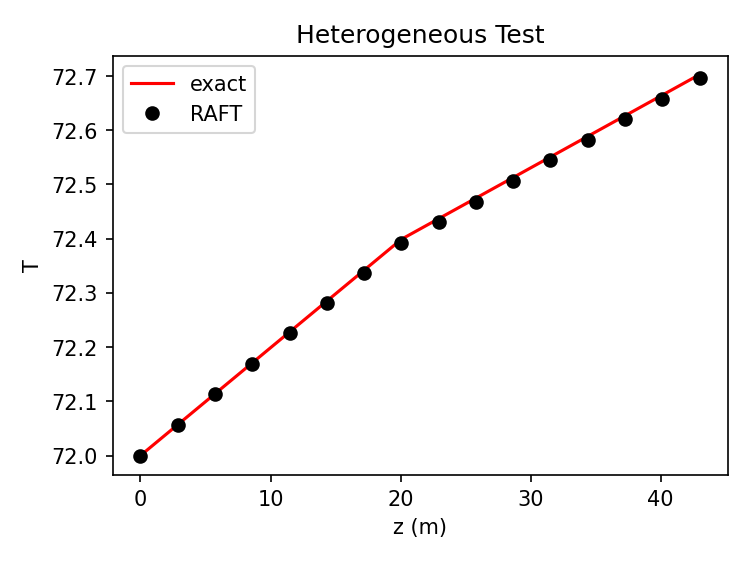
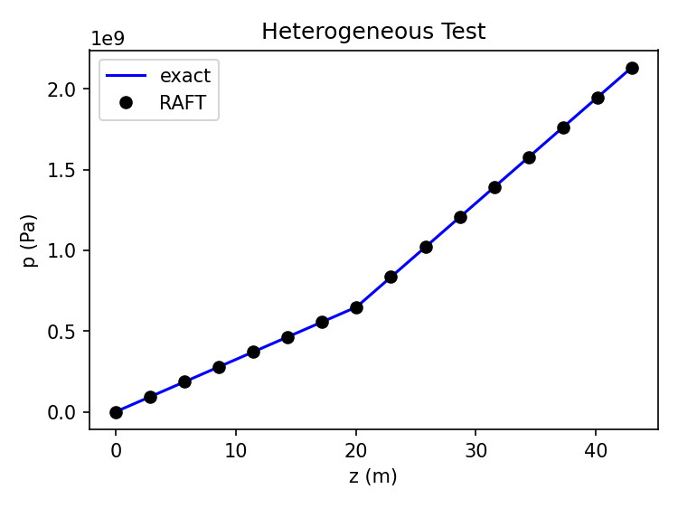
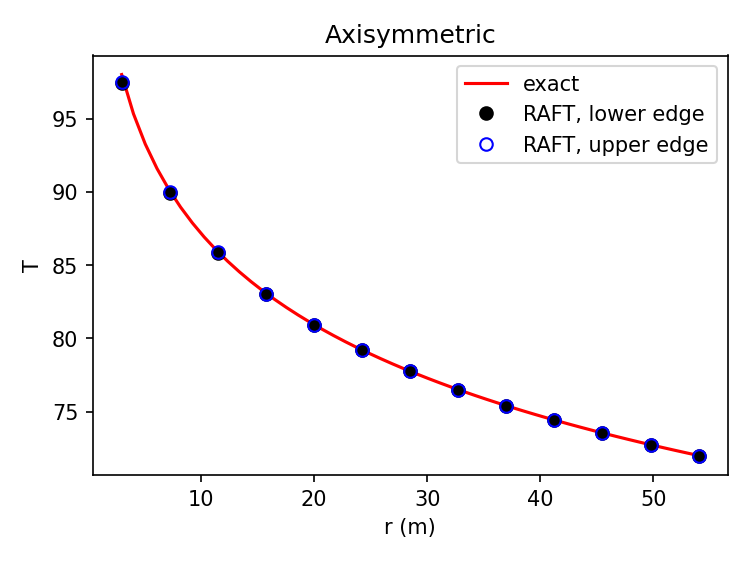
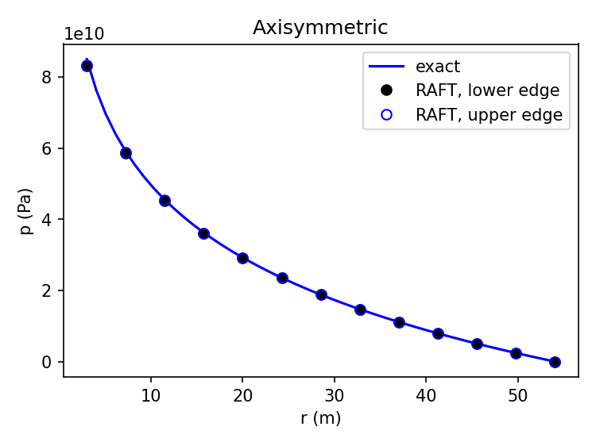
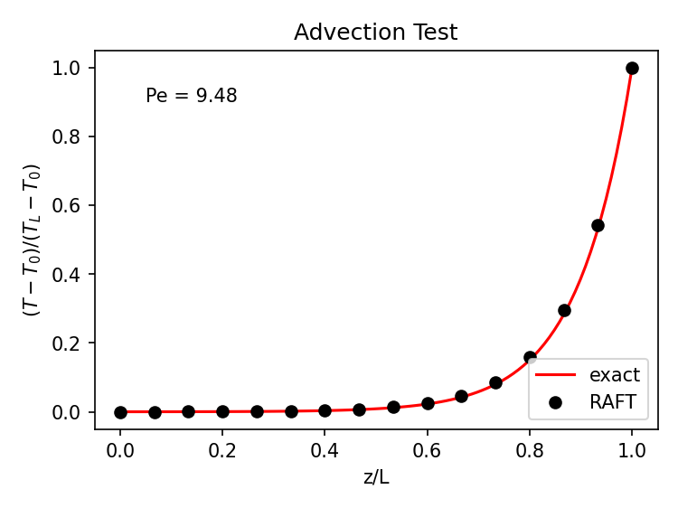
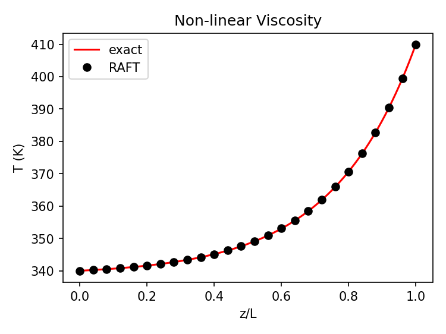
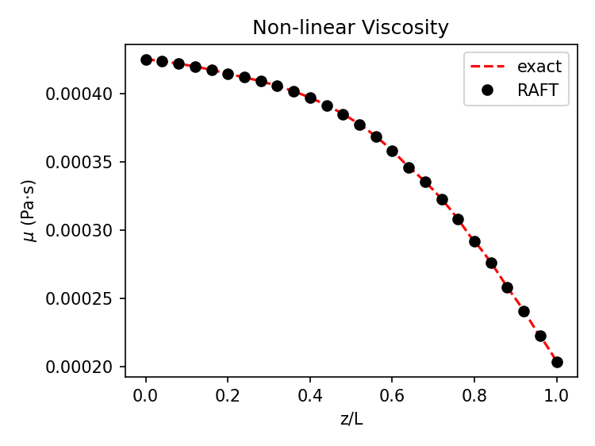
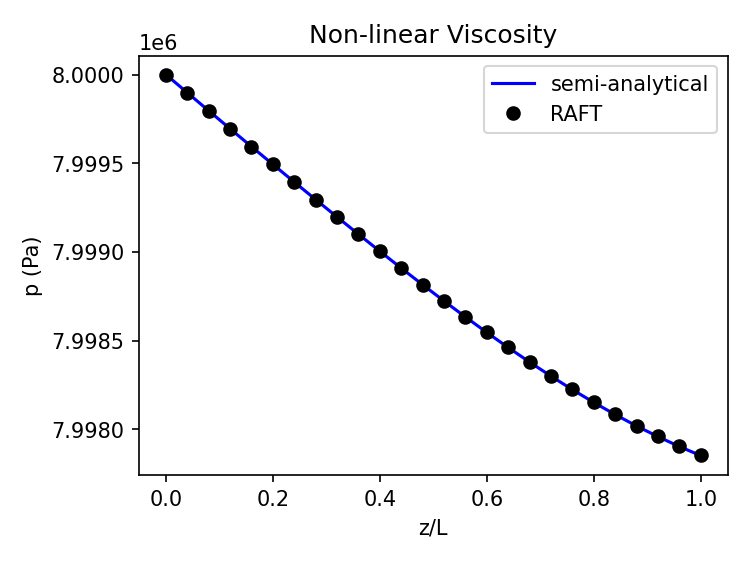
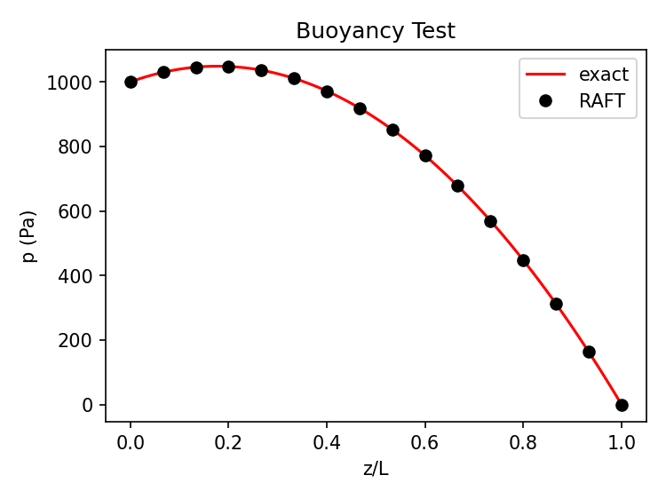
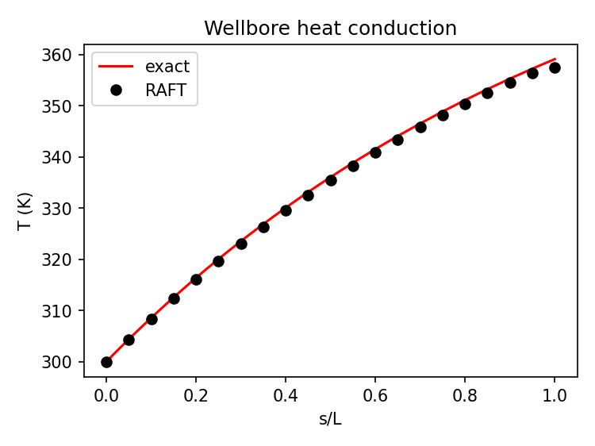

# Verification — Comparison Against Analytical Solutions

This section lists the automated tests that compare the finite element solution to an analytical (or semi-analytical) solution. Each entry states the problem setup, the assumptions that make an analytical solution possible, the solution itself, and the error metric used to pass or fail the test.

All tests solve a steady-state problem on a quasi-1D domain unless stated otherwise. Nodal errors are evaluated at the mesh nodes along a line through the domain.

## Table of Contents
- [Heterogeneous Conduction and Flow](#heterogeneous-conduction-and-flow)
- [Axisymmetric Conduction and Flow](#axisymmetric-conduction-and-flow)
- [Advection–Diffusion](#advectiondiffusion)
- [Non-linear Viscosity](#non-linear-viscosity)
- [Buoyancy](#buoyancy)
- [Wellbore Heat Exchange](#wellbore-heat-exchange)

## Heterogeneous Conduction and Flow

**Test:** `test_heterogeneous`

**Setup.** A column $0 \le z \le H$ made of two layers with different thermal conductivities $\lambda_1, \lambda_2$ and permeabilities $k_1, k_2$. Temperature $T_0$ and pressure $p_0$ are fixed at $z=0$. A uniform heat flux $q_T$ and fluid flux $q_p$ are prescribed at $z=H$.

**Assumptions.**
- Steady state, no advection, no gravity.
- Constant fluid density and viscosity $\mu$.
- Material properties are piecewise constant. The layer interface $z_I$ is the element boundary closest to the geometric interface, because regions are assigned per element.
- The uniform flux at $z=H$ makes the problem 1D in $z$.

**Analytical solution.** Under steady state, the flux is the same at every height. Fourier's and Darcy's laws then give piecewise-linear profiles:

$$T(z) = T_0 + \frac{q_T}{\lambda_1}\,z \quad (z \le z_I), \qquad T(z) = T(z_I) + \frac{q_T}{\lambda_2}(z-z_I) \quad (z > z_I)$$

$$p(z) = p_0 + \frac{\mu\, q_p}{k_1}\,z \quad (z \le z_I), \qquad p(z) = p(z_I) + \frac{\mu\, q_p}{k_2}(z-z_I) \quad (z > z_I)$$

with subscript 1 denoting the lower layer.

**Comparison.** Analytical and finite element (RAFT) nodal solutions.

_Heterogeneous Conduction and Flow: temperature_

_Heterogeneous Conduction and Flow: pressure_

**Error metric.** Sum of squared relative nodal errors for both fields:

$$e = \sum_i \left(\frac{T_i^{ex}-T_i}{T_i^{ex}}\right)^2 + \sum_i \left(\frac{p_i^{ex}-p_i}{p_i^{ex}}\right)^2 < 10^{-4}$$

## Axisymmetric Conduction and Flow

**Test:** `test_axisymmetry`

**Setup.** A 2D axisymmetric annulus $R_i \le r \le R_o$. A uniform heat flux $q_T$ and fluid flux $q_p$ (per unit area) enter at the inner radius $R_i$. Temperature $T_o$ and pressure $p_o$ are fixed at the outer radius $R_o$.

**Assumptions.**
- Steady state, no advection, no gravity.
- Homogeneous, isotropic, constant properties ($\lambda$, $k$, $\mu$, $\rho_f$).
- The solution depends only on $r$.

**Analytical solution.** The radial diffusion equation $\frac{1}{r}\frac{d}{dr}\left(r\frac{du}{dr}\right)=0$, with an inner-flux and an outer-Dirichlet condition, gives the logarithmic profile

$$T(r) = T_o - \frac{q_T R_i}{\lambda}\ln\frac{r}{R_o}, \qquad p(r) = p_o - \frac{\mu\, q_p R_i}{k}\ln\frac{r}{R_o}$$

**Comparison.** Analytical and finite element (RAFT) nodal solutions.

_Axisymmetric Conduction and Flow: temperature_

_Axisymmetric Conduction and Flow: pressure_

**Error metric.** Squared nodal errors along the two radial edges. Temperature errors are normalized by the mean exact temperature, and pressure errors by the exact pressure at $R_i$:

$$e = \sum_i \frac{(T_i^{ex}-T_i)^2}{\overline{T^{ex}}^{\,2}} + \sum_i \frac{(p_i^{ex}-p_i)^2}{(p^{ex}(R_i))^2} < 10^{-2}$$

## Advection–Diffusion

**Test:** `test_advection`

**Setup.** A column $0 \le z \le L$. Pressures $p_0 > p_L$ and temperatures $T_0$, $T_L$ are fixed at both ends.

**Assumptions.**
- Steady state, advection on, no gravity.
- Incompressible fluid with no thermal expansion and constant viscosity, so the Darcy velocity is uniform:

$$v = \frac{k}{\mu}\frac{p_0 - p_L}{L}$$

- Constant effective conductivity, $\lambda_e = \phi\lambda_f + (1-\phi)\lambda_s$.

**Analytical solution.** The 1D advection–diffusion equation $\rho_f c_{pf} v \frac{dT}{dz} = \lambda_e \frac{d^2T}{dz^2}$, with Dirichlet ends, has the solution

$$\frac{T(z)-T_0}{T_L-T_0} = \frac{e^{\mathrm{Pe}\,z/L}-1}{e^{\mathrm{Pe}}-1}, \qquad \mathrm{Pe} = \frac{\rho_f c_{pf}\, v\, L}{\lambda_e}$$

With SUPG stabilization, the nodal values should be close to exact.

**Comparison.** Analytical and finite element (RAFT) nodal solutions.

_Advection–Diffusion: normalized temperature_

**Error metric.** Sum of squared nodal errors in the normalized temperature $\theta = (T-T_0)/(T_L-T_0)$:

$$e = \sum_i (\theta_i^{ex}-\theta_i)^2 < 10^{-3}$$

## Non-linear Viscosity

**Test:** `test_nonlinear_viscosity`

**Setup.** A column $0 \le z \le L$. At $z=0$, pressure $p_0$ and temperature $T_0$ are fixed. At $z=L$, a mass flux $q_m$ and temperature $T_L$ are prescribed.

**Assumptions.**
- Steady state, advection on, no gravity.
- Constant fluid density $\rho_f$, so the prescribed mass flux sets a uniform Darcy velocity $v = |q_m|/\rho_f$ everywhere.
- Viscosity is the real-fluid (CoolProp) function $\mu(p,T)$.
- Constant effective conductivity $\lambda_e$.

**Semi-analytical solution.** Since $v$ is known in advance, the energy equation decouples from the pressure. The temperature then has the same closed form as the [advection–diffusion test](#advectiondiffusion):

$$T(z) = T_0 + (T_L - T_0)\,\frac{e^{\mathrm{Pe}\,z/L}-1}{e^{\mathrm{Pe}}-1}, \qquad \mathrm{Pe} = \frac{\rho_f c_{pf}\, v\, L}{\lambda_e}$$

The pressure follows from Darcy's law with the variable viscosity:

$$\frac{dp}{dz} = -\frac{\mu\big(p(z),T(z)\big)}{k}\,v, \qquad p(0)=p_0$$

This ODE is integrated with the trapezoidal rule on a fine grid. Because $\mu$ depends on $p$, a fixed-point iteration (three passes) makes the viscosity and pressure consistent with each other.

**Comparison.** Analytical and finite element (RAFT) nodal solutions.

_Non-linear Viscosity: temperature_

_Non-linear Viscosity: viscosity_

_Non-linear Viscosity: pressure_

**Error metric.** Relative $L_2$ nodal error in pressure, with the reference solution interpolated to the nodes:

$$e = \sqrt{\frac{\sum_i (p_i^{ex}-p_i)^2}{\sum_i (p_i^{ex})^2}} < 10^{-3}$$

## Buoyancy

**Test:** `test_buoyancy`

**Setup.** A vertical column $0 \le z \le L$ with gravity $g$ acting in $-z$. The bottom ($z=0$) is held at $T_0$ and $p_0$, the top ($z=L$) at $T_L$ and $p_L$, with $T_0 > T_L$.

**Assumptions.**
- Steady state, no advection, so the temperature is linear in $z$.
- Linear (Boussinesq-type) density with thermal expansion $\alpha_f$, reference density $\rho_0$, and an incompressible fluid:

$$\rho_f = \rho_0\left(1-\alpha_f \Delta T \frac{x}{L}\right)$$

- Constant viscosity and permeability.
- Steady mass conservation requires a uniform mass flux, $\rho_f\, v = \text{const}$.

**Analytical solution.** Darcy's law with gravity, together with the constant mass flux, gives

$$q = - \frac{\rho k}{\mu} \left(\frac{dp}{dz} - \rho g \right)$$

The analytical solution becomes

$$ p - p_0 = \rho_0 g L \left( \left(\frac{p_L - p_0}{\rho_0 g L} - \left( \frac{1}{2} \alpha_f \Delta T -1 \right) \right) \frac{\ln(1 - \alpha_f \Delta T \frac{z}{L})}{\ln(1 - \alpha_f \Delta T)} + \left( \frac{1}{2} \alpha_f \Delta T \frac{z}{L} -1 \right) \frac{z}{L}\right)$$

**Comparison.** Analytical and finite element (RAFT) nodal solutions.

_Buoyancy: pressure_

**Error metric.** Relative sum of squared nodal pressure errors:

$$e = \frac{\sum_i (p_i^{ex}-p_i)^2}{\sum_i (p_i^{ex})^2} < 10^{-5}$$

## Wellbore Heat Exchange

**Test:** `test_well_conduction`

**Setup.** A straight horizontal well of diameter $D = 2R$ and length $L$ passes through a rock block. The whole block is held at temperature $T_m$ and fixed pressure. Fluid enters the well inlet at mass flow rate $q$ and temperature $T_0$, and leaves through a pressure-controlled outlet.

**Assumptions.**
- Steady state, advection on, no gravity.
- Constant fluid properties ($\rho_f$, $\mu$, $c_{pf}$, $\lambda_f$).
- No perforations, so there is no mass exchange with the rock, and the mass flow rate is uniform along the well.
- Laminar, fully developed flow from the inlet onward, with Nusselt number $\mathrm{Nu}=4.01$ and heat transfer factor 1. The heat transfer coefficient is $h = \frac{Nu \lambda_f}{D}$.
- Axial conduction in the fluid is neglected.
- Frictional (pressure-work) heating follows Hagen–Poiseuille flow, giving a constant heat source $\Phi$ per unit length.

**Analytical solution.** Along the well coordinate $s$, the energy balance is

$$q\,c_{pf}\frac{dT}{ds} = h_c \pi D \,(T_m - T) + \Phi$$

With $T(0)=T_0$, the solution is

$$T(s) = T_0 + \left(T_m - T_0 + \frac{\Phi}{h_c \pi D}\right)\left(1 - e^{-\frac{h_c \pi D s}{qc_{pf}}}\right), \qquad \Phi = \frac{8\mu q^2}{\pi \rho_f^2 R^4}$$

The frictional term is negligible at the test's flow rate.

**Comparison.** Analytical and finite element (RAFT) nodal solutions.

_Wellbore Heat Exchange: fluid temperature along the well_

**Error metric.** Relative sum of squared nodal temperature errors at the well nodes:

$$e = \frac{\sum_i (T_i^{ex}-T_i)^2}{\sum_i (T_i^{ex})^2} < 10^{-5}$$
